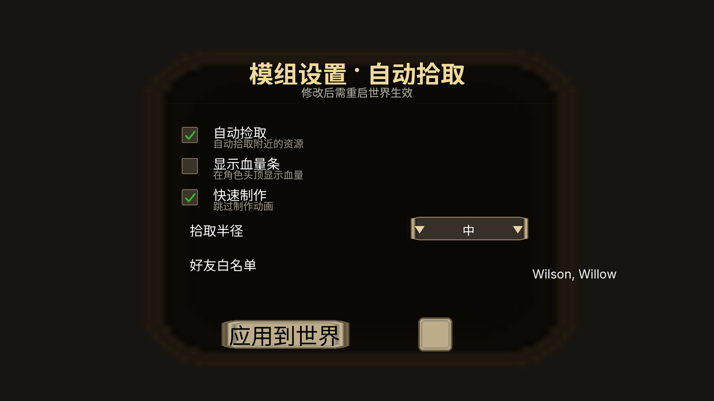
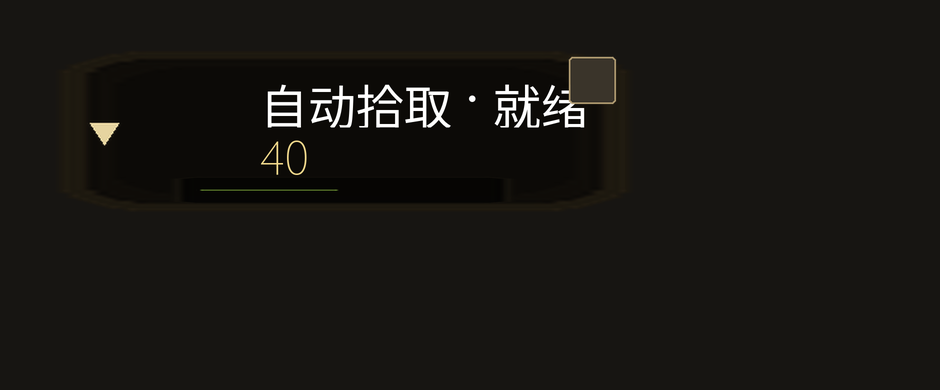

# DST UI Preview · 无头预览 Don't Starve Together 的 mod UI

不用启动游戏，就能把 DST mod 的界面**跑起来并看见**：
在真实的 Lua VM 里实例化你的 `Widget` 树，算出每个控件的位置/尺寸/纹理/文字，
再渲染成**高清 PNG**（可叠加动画）或**可交互 HTML**（悬停探针、缩放、动画时间轴）。

- 改一行 UI 代码 → 秒级出图，不用开游戏、不用进世界、不用等加载
- 点击交互可脚本化：`--click 640,300` 走真实的命中测试 + `OnControl` 点击流
- 动画可采样导出：`--capture 0.1 --anim` 得到 APNG 与带时间轴的 HTML
- 没有游戏图集也能看：没提供纹理时画「占位块 + 纹理名」，一眼看出缺哪张 `.tex`

```bash
# 1) 安装依赖（Python 3.9+）
pip install lupa pillow

# 2) 跑一个示例
python3 scripts/run_dst_ui.py --screen examples/mod_config_panel.lua \
    --style both --out /workspace/panel.png

# 3) 想看真实纹理？先造一份示例图集（或用游戏自带的 data/images）
python3 scripts/make_sample_atlas.py examples/textures
python3 scripts/run_dst_ui.py --screen examples/mod_config_panel.lua \
    --textures examples/textures --style both --out /workspace/panel_real.png
```

---

## 效果

`examples/mod_config_panel.lua`（真实纹理 + 渲染 1280×720）：



`examples/hud_widget.lua`（带补间/周期任务，下图为动画中的一帧）：



---

## 目录结构

```
runtime/                 Lua 侧「无头运行时」——模拟 DST 的 widget 体系
  bootstrap.lua          Class / Vector3 / 常量 / 全局桩 / require mock / 虚拟时钟 / 补间 / JSON
  widgets/               Widget 及内置控件（image, text, button, imagebutton, screen,
                         threeslice, spinner, menu, textedit, uianim）
  harness.lua            实例化入口屏幕、推进时钟、派发点击、采帧、输出报告
vision/vision_dst.lua    widget 树 → 绘制列表（draw list）
scripts/
  run_dst_ui.py          驱动：拼装并执行 Lua、解析图集、调用渲染器
  render_hires.py        绘制列表 → 高清 PNG / APNG（PIL 超采样 + 真实字体）
  render_html.py         绘制列表 → 自包含可交互 HTML
  make_sample_atlas.py   生成示例图集（XML + PNG），用于试用 --textures
examples/                示例屏幕（配置面板 / HUD 动画 / 冒烟测试）
assets/fonts/            渲染用字体（拉丁）
```

数据流：`你的 .lua` →（Lua 无头运行时）→ **绘制列表 JSON** →（渲染器）→ PNG / HTML。
绘制列表是纯数据，任何语言都能消费，方便集成进自己的工具链。

---

## 命令行

```
python3 scripts/run_dst_ui.py --screen <你的屏幕.lua> [选项]
```

| 选项 | 说明 |
| --- | --- |
| `--screen FILE` | **必填**。入口屏幕模块：返回类 / 工厂函数 / 类名字表的 `.lua` |
| `--mod NAME=PATH` | 额外注册到 `require` 的本地模块（多文件屏幕用，可多次） |
| `--class NAME` | 入口模块返回「类名字表」时，指定实例化哪个类 |
| `--style S` | `hires`=高清 PNG（默认）/ `html`=可交互网页 / `both` / `none`=只跑引擎出报告 |
| `--out FILE` | 输出路径（默认 `./dst_ui.png`；`both` 时 PNG 为 `*_hires.png`，网页为 `*.html`） |
| `--viewport WxH` | 视口，默认 `1280x720`（DST `SCALEMODE_PROPORTIONAL` 的基准分辨率） |
| `--bg #RRGGBB` | 画布背景色，默认 `#171512` |
| `--textures PATH` | DST 图集 `*.xml` 或其所在目录（可多次）。提供后按真实像素尺寸渲染并裁剪贴图 |
| `--default-tex-size WxH` | 无图集信息时的纹理占位尺寸，默认 `100x100` |
| `--pump SEC` | 实例化后推进的虚拟秒数，默认 `1.0`（让 `DoTaskInTime`/补间跑起来） |
| `--pump-dt SEC` | 虚拟时钟步长，默认 `1/30` |
| `--click X,Y` | 在该点命中并派发点击（走 `OnControl` 完整点击流，可多次） |
| `--hover X,Y` | 在该点派发悬停（获得焦点，触发 hover 纹理切换，可多次） |
| `--capture SEC` | 动画：按该间隔采样绘制帧（虚拟秒），0=关闭 |
| `--anim` | 额外导出 APNG（配合 `--capture`） |
| `--fps N` | APNG 帧率，0=按采样间隔推算 |
| `--max-frames N` | 动画帧上限（默认 240） |
| `--dump-json FILE` | 把引擎报告 JSON 落盘，便于离线重渲染/集成 |
| `--scale N` / `--ss N` | 输出放大倍数（默认 2）/ 超采样倍数（默认 3） |
| `--no-glyphs` | 不画文字（只看几何与纹理） |

退出码：`0` 无错误；`1` 运行错误或断言失败；`2` 用法/加载错误。

### 截图与交互

```bash
# 点第 1 个复选框（切换开关）+ 点「应用到世界」（改标题）
python3 scripts/run_dst_ui.py --screen examples/mod_config_panel.lua \
    --textures examples/textures --click 340,242 --click 510,600 \
    --style both --out /tmp/clicked.png

# 悬停在复选框上（触发 focus 纹理）
python3 scripts/run_dst_ui.py --screen examples/mod_config_panel.lua \
    --textures examples/textures --hover 340,242 --style hires --out /tmp/hover.png
```

### 动画

```bash
# 每 0.1 虚拟秒采一帧，导出 APNG（HTML 里还带可拖动的时间轴）
python3 scripts/run_dst_ui.py --screen examples/hud_widget.lua \
    --textures examples/textures --style both --capture 0.1 --anim --pump 3 \
    --out /workspace/hud.png
```

---

## 真实纹理（`--textures`）

DST 的 `.tex` 是 KTEX 容器，不能直接当图片读；但**图集 XML** 里有每个纹理的
归一化裁剪矩形，配合同名的 `.png`（工具解包后得到）就能还原真实像素：

```
data/images/frontend.xml + frontend.png
    ↓ 解析 <Element name="button_long.tex" u1=.. v1=.. u2=.. v2=..>
--textures data/images
    ↓
绘制列表里该纹理 → 真实像素尺寸 + 裁剪盒 → 渲染器贴图（并按 SetTint 乘算着色）
```

- 图集 `v` 轴按 OpenGL 底原点换算（`y0=(1-v2)*h, y1=(1-v1)*h`），与 DST 资源一致
- 没有提供图集的纹理 → 画**占位块**：斜纹底 + 左上角纹理名，一眼定位缺哪张图
- 报告里的 `widgets.placeholders` 会统计占位数量，`texmap` 记录解析结果

没有现成图集时，可以先用自带的生成器造一份示例图集来体验：

```bash
python3 scripts/make_sample_atlas.py examples/textures
```

---

## 坐标系与锚点（最容易踩坑的地方）

DST 与常见 UI 框架有两处不同，本工具严格照游戏语义实现：

1. **y 轴向上**：`SetPosition(0, 100)` 是**往上** 100；屏幕左上原点在渲染时才做翻转
2. **锚点是「相对父级哪条边/中心计量」**，不是「元素自身对齐方式」：

```lua
-- 挂到父级左上角，再往右下挪 200,100（教程里的“左减右加、上加下减”）
w:SetHAnchor(ANCHOR_LEFT)
w:SetVAnchor(ANCHOR_TOP)
w:SetPosition(200, -100)

-- 内容锚点（Image 的 RegPoint / Text 的 Align）：内容盒的哪个点落在位置上
img:SetHRegPoint(ANCHOR_LEFT)   -- 图片左边缘落在位置上（默认 MIDDLE 居中）
text:SetHAlign(ANCHOR_LEFT)     -- 文字左对齐（默认 MIDDLE 居中）
```

> 注意 `Text:SetSize()` 是**字号**；要设文本框用 `SetRegionSize(w, h)`。
> 而 `Widget:SetSize(w, h)` / `Image:SetSize(w, h)` 设的是控件尺寸。

渲染时的三点提醒：

- 文字**没有显式区域**时（`textAutoBox`），渲染器会用真实字体测量，再按 `xa/ya`
  把文本框摆到位置上——这与游戏的内容锚点语义一致
- 旋转为正即**逆时针**（y 向上坐标系），PNG 用 `rotate(+θ)`、HTML 用 `rotate(-θdeg)`
- 按钮（`Button`）自身没有尺寸，必须 `SetSize()` 才有可点击区域；点不到时工具会提示

---

## Lua 侧模拟了什么

`runtime/` 复刻了 mod 代码最常触达的那部分引擎（不是整个 DST）：

| 模块 | 覆盖 |
| --- | --- |
| `Widget` | 层级 `AddChild/RemoveChild/Kill`、`Show/Hide`、`Enable/Disable`、`SetPosition/SetScale/SetRotation`、`SetHAnchor/SetVAnchor/SetScaleMode`、焦点与 `OnControl`、`StartUpdating/OnUpdate`、`GetWidgetByName`、`SetSize/GetSize`、`DoTaskInTime/DoPeriodicTask` |
| `Image` | `SetTexture/SetSize/SetTint/SetHRegPoint/SetVRegPoint/SetEffect/ScaleToSize` |
| `Text` | `SetString/SetColour/SetSize(字号)/SetRegionSize/SetHAlign/SetVAlign/EnableWordWrap/SetTruncatedString/SetMultilineTruncatedString/SetAutoSizingString` |
| `Button` | `SetText/SetOnClick/SetOnDown/SetTextColour/OnControl` 点击流（含 `clickoffset`） |
| `ImageButton` | `SetTextures`（含 focus/down/disabled 切换）、`ForceImageSize`、`OnGainFocus/OnLoseFocus` |
| `Spinner` | `options/SetSelectedIndex/Next/Prev/UpdateText`、箭头按钮布局 |
| `Menu` | `AddItem/AddCustomItem` 五种样式、`AutoSpaceByText` |
| `TextEdit` | 编辑态切换、`SetValidChars/SetFormat/SetTextLengthLimit/idle_text_colour` |
| `ThreeSlice` / `UIAnim` | 结构正确的桩（纹理占位） |
| 全局 | `Class`、`Vector3`、`ANCHOR_*`、`SCALEMODE_*`、`CONTROL_*`、`*FONT` 字体别名、`TheSim/TheInput/TheFrontEnd/ThePlayer/TheNet`、`STRINGS`、`require` mock、`easing` |
| 时间 | 虚拟时钟：`DoTaskInTime` / `DoPeriodicTask` / 补间（`MoveTo/ScaleTo/RotateTo/TintTo` 真实插值）/ `StartUpdating` |

**没模拟到的调用**会记成警告而不是崩溃，报告里能看到完整清单 —— 这本身就是一份
「我的 UI 用了哪些预览工具还不支持的 API」清单。

---

## 用它当 Agent 技能

这个仓库的产物是**纯数据 + 命令行**，非常适合让 coding agent 闭环：

```bash
# 让 agent 改完 UI 代码后自检
python3 scripts/run_dst_ui.py --screen mod_screens/my_panel.lua --style none
# → {"errors":[],"warnings":[],"widgets":{"count":44,...},"draws":[...]}

python3 scripts/run_dst_ui.py --screen mod_screens/my_panel.lua \
    --style hires --out preview.png          # 看一眼版式
```

- `--style none` 拿 JSON：断言、错误、警告、控件树统计，适合自动化
- `--style hires/html` 拿像素：给人看版式与配色
- 报告里 `draws[]` 是稳定契约（`class/name/x/y/w/h/rotation/text/imageRef/...`），
  可自行写渲染器或做视觉回归对比

---

## 示例

| 文件 | 演示内容 |
| --- | --- |
| `examples/smoke.lua` | 最小屏幕：Image + Text + Button + 点击改文案 |
| `examples/mod_config_panel.lua` | 典型 mod 配置面板：标题/分隔线/三行自绘复选框/Spinner/TextEdit/底板+文字按钮 |
| `examples/hud_widget.lua` | HUD 部件：入场补间、`DoTaskInTime`、`DoPeriodicTask` 进度条、`StartUpdating` 呼吸缩放、旋转图标、点击折叠 |

```bash
for s in examples/*.lua; do
  python3 scripts/run_dst_ui.py --screen "$s" --textures examples/textures \
      --style both --out "/tmp/$(basename "$s" .lua).png"
done
```

---

## 已知限制

- **不是完整引擎**：只覆盖 UI 相关 API；`TheSim`、`ThePlayer`、`TheWorld` 等是桩，
  依赖真实存档/实体的逻辑不会真的执行（但不会崩，会记警告）
- **Lua 版本**：跑在真实 Lua VM（lupa / Lua 5.5）上，DST 的 Lua 5.1 差异由 shim 抹平
  （`unpack`、`getfenv`、`string.utf8*` 等），极端依赖 5.1 特性的代码可能需微调
- **`.tex` 不能直接解码**：真实像素需要图集 XML + 解包后的同名 PNG；
  只给 `.tex` 时按占位块渲染
- **文本度量是近似**：Lua 侧宽度为按字符类别的经验估算（供 `GetRegionSize` 等布局代码），
  渲染侧用真实字体测量；与游戏内的位图字体度量可能有几像素差异
- **不在游戏内验证**：本工具是「设计期快速迭代」，最终仍建议进游戏确认一次

## License

MIT
